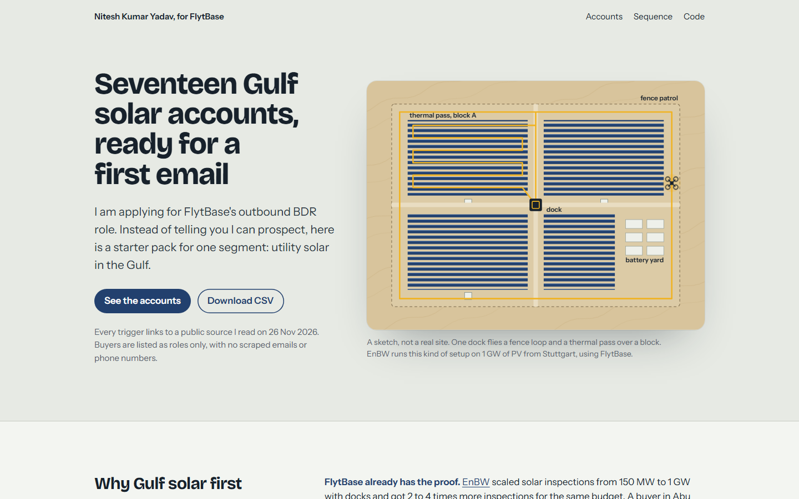
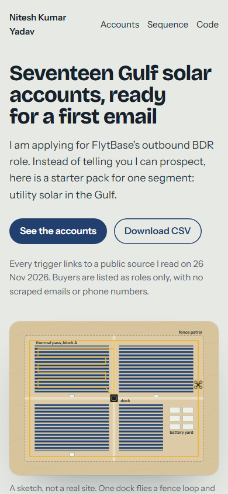

# Gulf solar outbound pack for FlytBase



Live page: https://flytbase-outbound.vercel.app

## Problem
FlytBase's outbound BDR role asks for someone who can find named enterprise accounts in energy, mining and critical infrastructure, and write a message that earns a reply. A CV can only say that. This repo tries to show it.

## What I made
- **17 accounts** in one segment: utility scale solar in the Gulf (UAE, Saudi Arabia, Oman, Qatar, Kuwait, Bahrain).
- For each: a public trigger with a link to the source, the role to reach, and a first line written for that account.
- A **4 touch sequence** (email, LinkedIn, email, email) that uses a different FlytBase proof on each touch.
- The reasoning: why this segment, how the triggers were found, and what was left out.

## Why this segment
FlytBase's own case studies point here: EnBW scaled solar inspections from 150 MW to 1 GW with docks, the featured story is a remote construction hub in Oman, and Aeronex became FlytBase's MENA master distributor in May 2025. The accounts listed cover over 22 GW of solar that is being built, financed or bid.

## Result
- `site/index.html`: the page, with a country filter and a copy button on each first line.
- `accounts.csv`: the same list as a spreadsheet.
- Every trigger was read from its source on 26 Nov 2026. Tier C rows are bid stage news and are marked as not confirmed.

## How it was built
I used Claude with web search to find project news, then opened each source and wrote the trigger in my own words. `build.py` holds the data and renders the page and the CSV. No personal names, emails or phone numbers are collected; buyer columns are job roles only.

```
python build.py          # writes site/index.html and accounts.csv
python shoot.py <url> shots/x   # screenshots at 1440 and 390, checks overflow and console errors
```

Made by Nitesh Kumar Yadav (final year B.Tech, ECE AI and ML, NSUT Delhi). Not affiliated with FlytBase.


